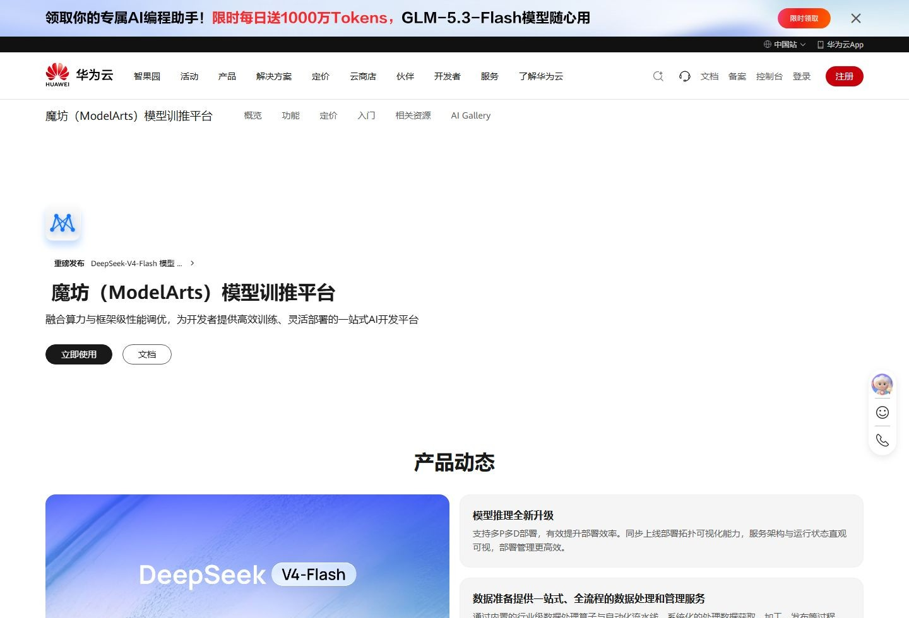

# 产品首屏

适用：产品页打开后的第一屏。ModelArts、GaussDB、ECS 都是这个骨架。

结构：顶栏之下，左对齐的产品名和一行说明，然后主按钮加次按钮（文档或控制台）。主按钮是近黑胶囊，字反白。说明用次要文字色，不超过两行。再往下才是动态、架构或规格，不和标题抢同一块底。

桌面一行排开；平板按钮可以留在标题下；手机按钮纵向叠放，标题改小一档。字号待标注，不在本资产里。

常用 token：`--porx-color-text-primary`、`--porx-color-text-secondary`、`--porx-color-bg--primary`、`--porx-color-text-inverse`。

禁忌：首屏不要铺辅助蓝当整屏底；不要在标题旁放超过两个按钮。

